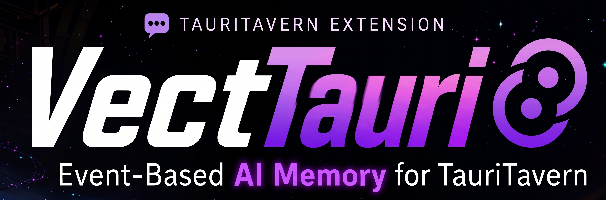

<p align="center">
  
</p>

# VectTauri — Advanced RAG for TauriTavern

> **Fork of [VectFox](https://github.com/KritBlade/VectFox)** by Kritblade — all VectFox credits belong to the original author. VectTauri adapts it for **TauriTavern** (Android).

VectTauri brings full RAG (Retrieval-Augmented Generation) memory to TauriTavern. Unlike the original VectFox, which needs the Similharity plugin inside SillyTavern's Node.js backend, VectTauri ships with a **built-in Similharity layer** that runs entirely on-device — no server, no Termux, no network setup required.

## ✨ Highlights

- **Zero setup** — install the extension and it works. Vectors are stored on-device through TauriTavern's native vector engine (Rust + redb + on-device embeddings)
- **Rich RAG metadata** — importance weighting, keywords, conditional activation, chunk groups, temporal data: everything the VectFox engine expects, preserved intact
- **Event-Based memory** — LLM-driven event extraction keeps meaningful story moments, not just recent messages

---

## 📋 Requirements

- **TauriTavern** (Android/desktop) — [Download](https://github.com/Darkatse/TauriTavern)

That's it. Everything runs on-device.

---

## 🚀 Installation

1. Open **TauriTavern**
2. Go to **Extensions** panel (puzzle piece icon)
3. Click **"Install Extension"**
4. Paste this URL:
   ```
   https://github.com/lunarcadedigital/VectTauri
   ```
5. Click **Install** and open **VectTauri Settings**

The **Similharity Mode** defaults to **Auto**: inside TauriTavern it uses the built-in on-device engine automatically. You can switch between **Auto** and **Built-in** under **VectTauri Settings → Similharity Mode**.

### Getting started

1. Open a chat and open **VectTauri → Vectorization**
2. Click **"Vectorize Content"** to index the conversation
3. Retrieval starts injecting relevant memories into your prompts automatically
4. Use the **Database Browser** and **Chunk Visualizer** tabs to inspect what's stored

---

## 🔄 Updating

Update the extension from **Extensions panel → Check for Updates**, or reinstall from the URL above.

---

## 📄 License

MIT License

---

## Credits

- **[KritBlade](https://github.com/KritBlade)** — Original VectFox & Similharity plugin
- **[Darkatse](https://github.com/Darkatse)** — TauriTavern
- **Lunarcade Digital** — TauriTavern adaptation

---

## Contributors

| Name | Division | Role |
|------|----------|------|
| Fajar Nugroho | Qa | Quality assurance & testing |
| Ayu Pratiwi | Web | Web development |
| Agus Pratama | Asset | 2D assets & visuals |
| Dewi Lestari | Architect | System architecture |
| Nina Salsabila | Research | Tech research & analysis |
| Ahmad Fauzi | Release | Release & CI pipeline |
| Gilang Permadi | Web | Web integration & optimization |
| Raka Wiraguna | Design | UI/UX design |
| Sari Dewi | Archive | Documentation & archival |
| Dimas Pratama | Fixing | Bug fixes & patching |
